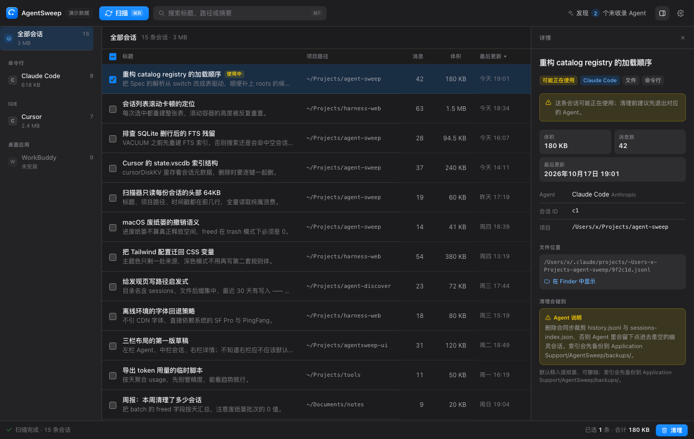

# AgentSweep

扫描本机 AI Agent 的会话记录，勾选后清理。**默认进废纸篓，可撤销。** 内置 63 款 Agent，其余的靠指纹发现。



<sub>截图用的是演示数据，不是真实会话。</sub>

## 下载与安装

从 [Releases](https://github.com/ruanbw/agent-sweep/releases) 下载
`AgentSweep-v<版本>-darwin-universal.zip`（Apple Silicon / Intel 通用），解压后把
`AgentSweep.app` 拖进「应用程序」。

当前是 ad-hoc 签名、未公证。首次打开被 Gatekeeper 拦下时，右键 →「打开」，或：

```bash
xattr -dr com.apple.quarantine /Applications/AgentSweep.app
```

只要命令行就下 `agentsweep-v<版本>-darwin-universal.tar.gz`，解压得到单个 `agentsweep` 二进制。
同页 `checksums.txt` 是 sha256 清单（`shasum -a 256 -c checksums.txt`）。产物命名规则见
[`docs/RELEASING.md`](docs/RELEASING.md)。

## 用法

```bash
agentsweep                                 # 打开窗口
agentsweep scan [--json]                   # 扫出会话表格
agentsweep clean --agent dsh               # 移入废纸篓（--permanent 直接删）
agentsweep discover                        # 找目录里没有的 Agent
agentsweep update --check                  # 只检查新版本
agentsweep serve --addr 127.0.0.1:8766     # 只开本机 HTTP（调试 UI / 无窗口）
```

应用会在后台检查更新，最多每 6 小时联网一次（设置里可关）；下载、sha256 校验、替换、重启全自动。

## 设计要点

- **一个 Agent 是一份声明。** `internal/catalog/spec.go` 只四个字段（数据根、会话形态、索引位置、说明），
  新增内置 Agent = 往 `builtin.go` 加一条数据，不碰引擎。
- **目录里没有的 Agent 靠指纹发现。** 看内容而不是白名单：JSONL 里的 `role`/`content`、SQLite 的表名、
  是不是「一会话一目录」。命中后生成可直接保存的适配器草稿。
- **删除可逆。** 备份索引 / SQLite → 正文进废纸篓 → 裁索引 → 写 journal，撤销按 journal 逆序还原。
  「进废纸篓」不计入「已释放空间」，UI 上分开显示。

## 构建

```bash
make build                     # bin/AgentSweep
make app                       # AgentSweep.app（手工拼 bundle，不依赖 wails CLI）
make run
make test
make dist VERSION=0.1.0        # .app zip + CLI tar.gz + checksums.txt
```

要求 Go 1.27+、Xcode Command Line Tools（cgo 链接 WebKit）、macOS 13+。

代码分布：`main.go` 是 GUI / CLI 两个入口；`internal/{catalog,probe,session,scan,clean,gui}`
依次是 Agent 声明、指纹发现、会话模型、扫描、清理、Wails 壳与前端资源。
前后端契约只有 [`docs/api.md`](docs/api.md)，没有 bindings 生成器、websocket 和 node 工具链。

## 已知边界

- 只在 macOS 上验证过；Linux / Windows 要补一份路径表（`~/.config`、`%APPDATA%`）。
- SQLite 型会话算不出单条体积，列表显示 0，真实释放量按 VACUUM 前后文件差算。
- Agent 正在运行、库被锁时删除会失败并报错，不会静默跳过。

## 文档

[发版](docs/RELEASING.md) · [HTTP API](docs/api.md) · [新增 Agent](docs/adding-agents.md) ·
[UI 设计](docs/design/README.md)
