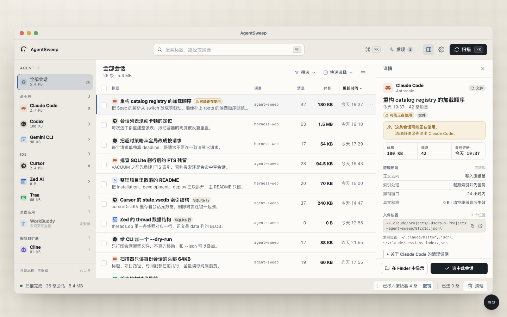

# AgentSweep — UI / UX 设计方案

> 一套面向 macOS 桌面工具 **AgentSweep** 的完整 UI/UX 设计：视觉系统、主题规范、
> 信息架构、核心流程、中文文案，以及一个可点击的高保真原型。
>
> 设计方向：**延续现有 macOS 原生质感，做系统性升级**。
>
> 真实应用已按本方案落地：`internal/gui/assets/` 使用同一套 token、布局与交互；
> 本目录的原型保留为设计参考与验收基线。



<p align="center"><sub>1440×900 · 浅色。深色与全部状态见 <a href="screenshots/">screenshots/</a>。</sub></p>

---

## 先看这里

```bash
open docs/design/prototype/index.html
```

- 双击即可打开，`file://` 直接运行；无网络、无构建、无依赖。
- 原型底部有一条**原型控制台**：切换浅色/深色、演示状态（扫描中/空/无结果/部分失败）、
  打开清理确认/发现/设置/命令面板/快捷键。
- 想直接看某个状态，可用 URL 参数：

```
index.html?theme=dark&state=scanning
index.html?panel=review
index.html?panel=discover&theme=light
index.html?state=empty&dock=0
```

| 文件 | 内容 |
|---|---|
| [`DESIGN.md`](DESIGN.md) | 视觉与主题设计系统（颜色、字体、间距、组件、动效、无障碍、反模式） |
| [`ux-flows.md`](ux-flows.md) | 信息架构、9 条核心流程、状态矩阵、键盘映射、完整中文文案库 |
| [`prototype/index.html`](prototype/index.html) | 高保真可交互原型 |
| [`prototype/CONTRACT.md`](prototype/CONTRACT.md) | 原型 DOM / 状态 / 交互契约（实现与评审用） |
| [`screenshots/`](screenshots/) | 26 张状态截图（浅色 + 深色）+ 改造前参考 |
| [`qa-report.md`](qa-report.md) | 验收报告：交互回归、无障碍、响应式 |
| [`tools/`](tools/) | 零依赖 Chrome CDP 截图/回归工具与可复现断言脚本 |

---

## Design Read

> 这是一个给开发者的本机清理工具：他们每天产生大量 AI 会话文件，想清掉旧的、又怕删错。
> 界面应当是安静的 macOS 原生工具，而不是仪表盘或营销页。
> 语言：暖单色 + 唯一石板蓝强调色；密度中等；motion 克制；键盘优先。

对应的四个技能：

| 领域 | 技能 | 落地方式 |
|---|---|---|
| 视觉设计 | `minimalist-skill` | 暖纸单色、排版对比、1px 发丝线、极少阴影、muted 语义色 |
| 主题设计 | `stitch-skill` | 语义化 `DESIGN.md`：atmosphere / color roles / type / components / motion / banned patterns；明暗双主题 |
| 交互设计 | `soft-skill` | 有重量的微交互、按钮内嵌图标、spring 曲线、浮层编排；按桌面工具克制裁剪 |
| 审计 | `redesign-skill` | 先 scan → diagnose 现有界面，再做 targeted upgrade，不推倒重来 |

> 说明：`soft-skill` 原本面向营销站点（超大留白、Double-Bezel 卡片、胶囊按钮）。
> 这里是数据密集的桌面工具，只取它的**动效编排与微交互**方法，明确覆盖它的留白/胶囊规则；
> 视觉密度与几何由 `minimalist-skill` 决定。

---

## 验收结果

- 截图矩阵 **26/26 PASS**（浅色/深色 × 13 个场景，1440/1180/960 视口）。
- 主流程断言 **33/33 PASS**，边界场景 **17/17 PASS**。
- console error / warning **0**，外部请求 **0**，横向溢出 **0**。
- 无阻断/高优先级问题；剩余为设置列表滚动、长标题省略等 Low 级打磨项。
- 详见 [`qa-report.md`](qa-report.md)。

复现：

```bash
node docs/design/tools/shoot.mjs matrix --base docs/design/prototype/index.html \
  --out docs/design/screenshots --report /tmp/shots.json --strict
node docs/design/tools/qa-flows.mjs
node docs/design/tools/qa-edge-cases.mjs
```

## 为什么要改

现有界面已经能跑，三个栏、搜索、扫描、清理、撤销都在。问题不在「缺功能」，
而在**信任与状态没有被设计**：

1. **浏览即选择。** 首次加载自动勾选第一条，用户只是看详情，清理按钮已经亮了。
2. **空间账目含糊。** 顶部只显示「已选 1 条 · 合计 180 KB」，没有说明进废纸篓后
   真实释放是 0。清理确认也只列 Agent 名字，用户无法核对「到底动了什么」。
3. **撤销藏得太深。** 唯一的撤销在设置抽屉的最近清理里；清理后的 toast 只告诉你成功。
4. **扫描状态挤在状态栏一行字。** 进度、当前 Agent、失败项都不显眼，扫描中也没有局部反馈。
5. **没有筛选。** 只有搜索。用户想「清掉 30 天前的空会话」只能自己翻。
6. **没有键盘路径。** 除了 ⌘F/⌘R/⌘A，表格不能用 J/K 移动、空格勾选。
7. **Agent 身份在列表里缺失。** 全部会话视图里，必须点开右侧才知道这行属于谁。
8. **活动会话只靠一行黄条。** 没有在行、状态栏、确认框里形成一致的警告链。
9. **空/错误状态弱。** 部分 Agent 读取失败时没有可操作的提示；空列表只有一句「扫描」。
10. **发现是一个侧面板，不是一条流程。** 置信度、证据、收录后的变化都不够清楚。

这次升级逐条回应，并把领域里最关键的一件事做成视觉母题：
**「空间账本」—— 移入废纸篓多少、真实释放多少、索引备份在哪里，永远分开写。**

---

## 设计的六个决定

### 1. 浏览 ≠ 选择（最重要的交互改动）

- 点击行、↑↓、J/K 只移动**焦点**，详情跟随，不勾选。
- 复选框、空格、X、⌘A、快速选择才进入**选择**集合。
- 首次加载自动聚焦第一条，因此详情不空白；但清理按钮保持禁用。
- 结果：误清理概率显著下降，用户可以放心用方向键翻阅。

### 2. 空间账本是确认框的主体

清理确认不再只问「清理吗？」，而是给出一张可核对的账：

```
会话正文    180 KB   移入废纸篓 · 不释放
索引备份     已备份   保留在应用支持目录
真实释放      0 B    清空废纸篓后生效
```

永久删除模式下，第一行和总计改为危险色，并要求勾选「我明白永久删除无法恢复」。
状态栏、toast、设置里的批次记录都复用同一套数字语言。

### 3. 可逆性有三处出口

- **toast**：清理后立刻出现「已移入废纸篓 3 条 · 撤销」，6 秒。
- **状态栏批次回执**：可撤销批次一直在，直到下次清理。
- **设置 → 最近清理**：完整批次历史，带模式、条数、真实释放与撤销。

撤销后给明确回执：「已恢复 3 条会话」。不静默。

### 4. 扫描是就地发生的，不打断浏览

- 顶栏 2px 进度线 + 状态栏 `12/30 · Cursor` + 侧栏当前 Agent 状态点脉冲。
- 扫描中列表保持可用，用户可继续筛选、看详情。
- 扫描失败就地出现 issue banner：`2 个 Agent 读取失败 · 查看`，展开后是每个 Agent 的原因与重试。
- 首次加载才用骨架屏，重复扫描不闪空。

### 5. 键盘优先，但不惩罚鼠标

J/K 或 ↑↓ 移动焦点、空格勾选、Shift 连选、⌘K 命令面板、⌘R 扫描、
⌘, 设置、⌘Z 撤销、? 快捷键表。所有焦点环可见，浮层有焦点陷阱与归还。

### 6. 原生 macOS 的质感，不是网页模仿 macOS

- SF Pro + PingFang SC，系统字体，不加载网络字体。
- 暖纸画布、1px 发丝线、平面主表面；阴影只给真正浮起的抽屉、对话框、菜单。
- 窗口栏的交通灯在原型里模拟；生产环境使用系统原生窗口栏，不自己画。
- 深色模式是完整重绘，不是反相。

---

## 视觉系统速览

| 项目 | 决定 |
|---|---|
| 画布 | 浅色暖纸 `#F4F2EC` / 深色墨 `#101317` |
| 文字 | 墨 `#1B1F26`，次级 `#545C68`，元信息 `#646C78` |
| 强调色 | 单一石板蓝 `#3F6599`（深色模式 `#93B6E3`） |
| 语义色 | 警告 `#8A5A12`、危险 `#B23A32`、成功 `#2E6F5E` |
| 字体 | `-apple-system` / SF Pro / PingFang SC；等宽 `SF Mono` |
| 间距 | 4pt 基；行高 56（紧凑 42）；顶栏 56；状态栏 44 |
| 圆角 | 控件 7 / 卡片 9 / 抽屉 12 / 窗口 14；胶囊只给徽标 |
| 阴影 | 主表面无阴影；浮层用带色相的大扩散软阴影 |
| 动效 | 120–240ms，`cubic-bezier(.2,.8,.2,1)`；只动 transform/opacity |
| 图标 | 1.75px 描边线性图标 + Agent 官方品牌矢量图 |

完整 token、组件规格、反模式见 [`DESIGN.md`](DESIGN.md)。

---

## 界面地图

```
窗口栏（模拟）
┌─────────────────────────────────────────────────────────────────┐
│ ⌘ 品牌        [搜索 ⌘F]              [发现 2] [详情] [设置] [扫描] │
├──────────┬────────────────────────────────────┬─────────────────┤
│ 全部会话  │ 全部会话   26 条 · 5.4 MB  [筛选][快选][密度] │ 详情        │
│ 命令行 4  │ ┌────────────────────────────────┐ │ Agent 身份   │
│  IDE 3    │ │ ☐ 标题 / 摘要     项目  体积  时间 │ │ 标题 / 徽标  │
│  扩展 1   │ │ ...                            │ │ 警告 / 统计  │
│  未安装   │ │                                │ │ 路径 / 影响  │
│ 隐私声明  │ └────────────────────────────────┘ │ 在 Finder   │
├──────────┴────────────────────────────────────┴─────────────────┤
│ ◉ 扫描完成 · 26 条   [批次回执↶]  已选 3 条 · 180 KB  [清理 3 条] │
└─────────────────────────────────────────────────────────────────┘
```

浮层：设置抽屉（420）、发现抽屉（640）、清理确认（560，含空间账本）、
命令面板（600）、快捷键表、筛选/快速选择浮层、右键菜单、toast。

---

## 核心流程（详见 ux-flows.md）

1. **首次打开** — 骨架 → 自动扫描（可关）→ 聚焦第一条，不选中。
2. **扫描** — 进度线 + 当前 Agent + 就地 issue；可继续浏览。
3. **浏览 / 筛选 / 排序** — 搜索、存储/时间/体积、排序、快速选择。
4. **选择** — 复选框 / 空格 / Shift / ⌘A；跨筛选保留并明确提示隐藏选中。
5. **清理（废纸篓）** — 确认账本 → 移入废纸篓 → toast + 批次回执 → 撤销。
6. **清理（永久）** — 危险色 + 必须勾选确认 + 真实释放数字。
7. **撤销** — 三处入口；恢复后回执；批次变不可撤销。
8. **发现** — 置信度 + 证据 + 一键收录 → 侧栏即时出现新 Agent。
9. **设置** — 清理方式、确认、快照、自动扫描、外观、最近清理、备份位置。
10. **失败** — issue banner、就地重试、不弹 alert。

---

## 原型可体验的操作

- 点 Agent 筛选；搜索；点表头排序；打开筛选浮层组合条件。
- 点行只更新详情（不勾选）；空格 / 复选框 / Shift 连选 / ⌘A。
- 点「清理 3 条」看空间账本；切永久删除看警告与确认勾选；确认后撤销。
- ⌘K 命令面板、? 快捷键表、右键行菜单、⋯ 菜单。
- 扫描按钮看进度；控制台切「部分失败」看 issue banner。
- 设置里切外观/密度/清理方式；发现抽屉收录 Warp Agent。
- 控制台切浅色/深色、空列表、无结果、紧凑密度。

---

## 落地建议（不修改应用代码的前提下）

1. **先 token 后布局。** 把 `DESIGN.md` 的 CSS 变量与字体栈搬进 `internal/gui/assets/app.css`，
   现有类名不变，先统一颜色/间距/阴影/焦点态。
2. **再交互语义。** 把「焦点 vs 选择」拆开：新增 `focusUid`，点击行只聚焦；
   复选框/空格才改 `selected`。这是收益最大、风险可控的一步。
3. **再空间账本。** 在删除确认与状态栏引入「移入废纸篓 / 真实释放」双数字；
   后端 `freed` 语义已经正确（trash 为 0），主要是文案与展示。
4. **再补键盘与筛选。** J/K、空格、Shift 连选、快速选择预设；筛选先做前端过滤。
5. **最后做发现流程与命令面板。** 依赖 `/api/discover` 与 `/api/adapters`，接口已具备。
6. **动效与暗色最后校准。** 用原型的 token 直接替换，减少二次设计。

---

## 验收

- 原型在 `file://` 下无 console error、无网络请求。
- 浅色/深色、1440/1180/960 三档宽度，无横向滚动与重叠。
- 关键交互、焦点环、对比度、`prefers-reduced-motion` 均通过，见 [`qa-report.md`](qa-report.md)。
- 截图见 [`screenshots/`](screenshots/)。

---

## 待定问题

- **撤销窗口**：批次永久保留还是按时间清理？当前沿用「journal 保留，UI 只展示最近 5 条」。
- **永久删除的二次保护**：本设计用「勾选确认」；是否还需要输入 Agent 名取决于风险评估。
- **跨 Agent 批次**：一次清理多 Agent 会写多份 journal，撤销按钮语义是「撤销这一批」还是
  「逐 Agent 撤销」？当前按批次整体撤销。
- **扫描取消**：当前 API 不支持取消，界面只做进度与禁用重复触发。
- **自定义适配器的编辑**：发现收录后目前只能删除，是否要在设置里提供编辑，待产品决定。
